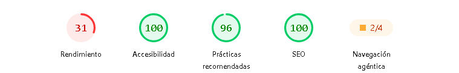

# Portfolio web de Malena Hilt

Trabajo Final de Diseño UX-UI 2026 · Licenciatura en Sistemas de Información · FCyT, Sede Concepción del Uruguay.

## Links

- **Sitio publicado:** https://melenaportfolio.netlify.app/
- **Figma (research, wireframes, design system y prototipo):** https://www.figma.com/design/Mojk0jitBHig38mTjvUlt4
- **Repositorio:** https://github.com/malenahilt/tp-final-portfolio

## Concepto visual

Tres palabras clave: **clara, cálida, precisa**.

| Elemento | Decisión |
|---|---|
| Fondo | Crema `#FAF7F2` |
| Primario | Verde petróleo `#1F4D47` |
| Acento (llamados a la acción) | Terracota `#B4431F` |
| Texto | `#1E1E1E` |
| Tipografías | Fraunces (títulos) y DM Sans (texto) |

El diseño visual es propio. De la referencia del docente se tomó solo la arquitectura de información.

## Stack

- HTML5 semántico
- CSS3 con variables (`:root`), Flexbox y Grid, mobile-first
- JavaScript vanilla (solo para el menú mobile)
- Sin frameworks ni constructores visuales

## Estructura

```
index.html            Página principal (one-page con anclas)
caso-turnos-vet.html  Caso de estudio completo
404.html              Página de error personalizada
css/styles.css        Estilos y design system
js/main.js            Menú mobile
assets/               Favicon, imagen Open Graph e imágenes de proyectos
```

## Accesibilidad y performance

- Contraste mínimo 4.5:1 en texto normal y 3:1 en texto grande.
- Navegable con teclado, con foco visible y link "Saltar al contenido".
- Menú mobile con `aria-expanded` y `aria-controls`.
- Se respeta `prefers-reduced-motion`.
- Breakpoints probados: 375 px, 768 px y 1280 px, sin scroll horizontal.
- Fuentes con `font-display: swap` (2 familias).

Captura de Lighthouse (mobile): 

## Fuentes de templates y recursos

- No se usó ningún template: el sitio se escribió desde cero a partir del diseño de Figma.
- Tipografías: [Fraunces](https://fonts.google.com/specimen/Fraunces) y [DM Sans](https://fonts.google.com/specimen/DM+Sans) (Google Fonts).
- Las ilustraciones de proyectos y retratos son SVG propios, y deben reemplazarse por capturas reales y una foto.
- Arquitectura de información tomada del portfolio de referencia: https://ernesto-ledesma-portfolio.vercel.app/

## Uso de IA

Se usó IA (Claude, de Anthropic) como ayuda durante el trabajo. Se declara acá qué se generó con su ayuda y cómo se revisó:

- **Código:** ayudó a desarrollar el HTML, el CSS y el JavaScript del sitio a partir del diseño de Figma.
- **Estética:** dio opiniones y propuestas sobre la paleta, las tipografías y la presentación visual, que después se revisaron y se aceptaron o se ajustaron.
- **Diseño en Figma y textos:** ayudó a armar el archivo de Figma (research, wireframes, design system y pantallas) y a redactar los textos del portfolio. Los proyectos, la experiencia y los datos de contacto son ficticios pero verosímiles, como permite la consigna.

### Nota sobre la foto

En la sección "Sobre mí" iría un retrato de la persona, como pide la consigna. Como decisión informal y sin intención de que sea una foto seria, se eligió poner una foto de mi gato. Se puede reemplazar por un retrato personal en cualquier momento.

## Cómo se publica (GitHub Pages)

1. Subir todos los archivos de esta carpeta a la rama `main` del repositorio.
2. En GitHub: **Settings → Pages**.
3. En **Source** elegir **Deploy from a branch**, rama `main` y carpeta `/ (root)`.
4. Esperar 1 a 2 minutos. El link aparece arriba en esa misma pantalla.
5. Cada vez que se haga un commit a `main`, el sitio se actualiza solo.
